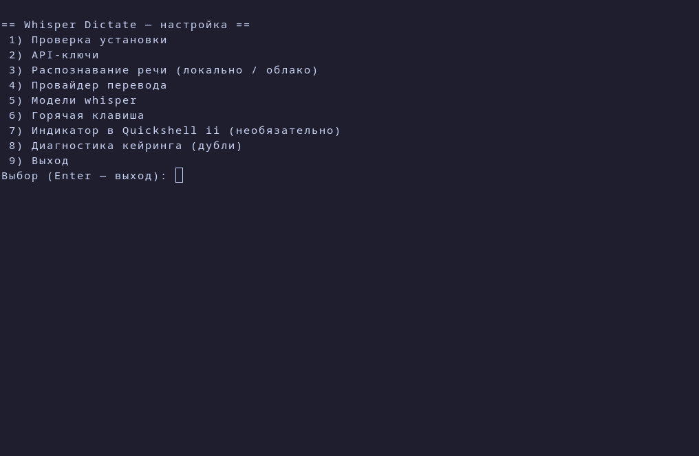
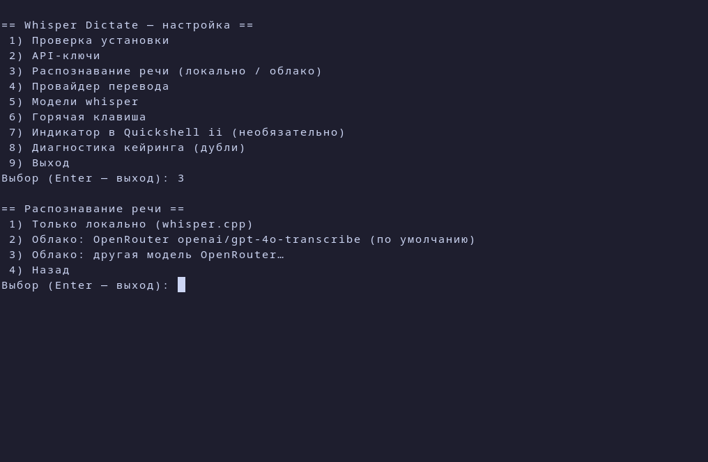

# Nata

Голосовая диктовка для Linux (Wayland). Команды и конфиг по-прежнему называются `whisper-dictate`. Нажал горячую клавишу, говоришь, нажал её ещё раз — распознанный текст вставляется в активное окно.




## Как это работает

1. **Запись.** Первый запуск `whisper-dictate` (по умолчанию горячая клавиша `SUPER + U`) начинает запись с микрофона через PipeWire (`pw-record`, 16 кГц, моно). Второй запуск останавливает её.
2. **Разбиение.** Длинная запись режется на куски по `CHUNK_SECONDS` (по умолчанию 120 с), чтобы каждый кусок распознавался отдельно.
3. **Распознавание (STT).** Каждый кусок идёт либо в облако (OpenRouter, Gemini), либо в локальный `whisper-cli` (whisper.cpp). Если облако недоступно или вернуло ошибку, кусок распознаётся локально.
4. **Перевод (необязательно).** Если включён, текст переводится через DeepL, Gemini, OpenRouter или локальную модель.
5. **Вставка.** Текст кладётся в буфер обмена (`wl-copy`) и вставляется в окно через `ydotool` (Ctrl+V).

На Hyprland скрипт дополнительно запоминает окно, из которого начали диктовать, и возвращает фокус туда перед вставкой. Раскладка для вывода берётся из окна-получателя. На других окружениях текст вставляется в то окно, которое активно в момент вставки.

## Приватность

По умолчанию распознавание **полностью локальное**: аудио не покидает компьютер. Облако включается явно (`STT=openrouter` или `STT=gemini`) и требует API-ключа. Перевод через облако так же включается отдельно.

## Требования

- Wayland с `wl-clipboard`, `ydotool` (запущен `ydotoold`), PipeWire (`pw-record`), `ffmpeg`, `jq`, `fish`, `libsecret` (`secret-tool`), `libnotify`, `curl`.
- Для локального распознавания нужны `whisper-cpp` (`whisper-cli`, ставится из репозитория как зависимость пакета) и модели `ggml-*.bin`, которые уже лежат на диске. Модели whisper не скачиваются.
- Распознавание идёт на видеокарте через `ggml-vulkan` (зависимость пакета; AMD/Intel/NVIDIA). Без GPU whisper работает на процессоре, но в разы медленнее: `whisper-dictate --test` об этом предупредит.
- Локальный перевод: модели OPUS-MT (русский ↔ английский, ~240 МБ каждая) и движок ctranslate2 ставятся кнопками в GUI на странице «Перевод» или командой `whisper-dictate-setup mt download zle-en|en-zle` / `mt engine`. Папка задаётся ключом `MT_MODEL_DIR`.
- Для GUI-настройки: `python-gobject` и `gtk4` (ставятся как зависимости пакета). Для TUI в терминале: `fzf`. Без него работает CLI.

Привязки к окружению нет: основной сценарий работает на Hyprland, KDE Plasma, GNOME и других Wayland-окружениях. Quickshell не нужен.

## Установка

Одной командой (клонирует репозиторий и собирает пакет `nata` через `makepkg -si`):

```
bash -c "$(curl -fsSL https://raw.githubusercontent.com/PHONE1X/nata/master/install.sh)"
```

Или вручную из клона:

```
git clone https://github.com/PHONE1X/nata && cd nata/packaging/nata && makepkg -si
```

Публикация в AUR пока не сделана; когда появится, пакет будет ставиться через `paru -S nata`.

Установка раскладывает:

- `/usr/bin/whisper-dictate`, `/usr/bin/whisper-dictate-setup`, `/usr/bin/whisper-dictate-gui`;
- `/usr/lib/whisper-dictate/` (библиотеки и заготовки интеграции Quickshell);
- `/etc/whisper-dictate/dictate.conf` (системный конфиг);
- `/usr/share/whisper-dictate/secrets.env.example`;
- `.desktop`-файлы в `/usr/share/applications/`.

После установки запустите `whisper-dictate-gui` (или `whisper-dictate-setup`).

## Настройка

Окно настройки (`whisper-dictate-gui`) — основной способ. Все разделы в одном окне:

- **Автонастройка** — кнопка в шапке окна, работает с любой страницы. Nata определяет видеокарту, видеопамять, процессор и ОЗУ и спрашивает одно: локально или в облаке. Локально — ставит нужный ускоритель, качает подходящую модель whisper, VAD и OPUS-MT (если ключ DeepL или Gemini уже сохранён, перевод не трогаем). В облаке — спрашивает ключи OpenRouter и DeepL/Gemini, модель распознавания выбирает сама из живого списка OpenRouter, локальную модель качает про запас. То же из терминала: `whisper-dictate-setup auto local` или `auto cloud deepl|gemini|local`.
- **Последний запуск** (на страницах «Автонастройка» и «Распознавание»): где на самом деле распознавали — в облаке или на этом компьютере, почему облако отказалось (например, не хватает $0.50 на балансе) и сколько заняло. Там же — остаток баланса OpenRouter. Из терминала: `whisper-dictate-setup last`.

- **Распознавание**: облако OpenRouter (выпадающий список всех моделей распознавания с ценой за минуту, или любая модель вручную) либо локально. Ускоритель: Авто / Vulkan / ROCm / CUDA / процессор; недостающий пакет (`ggml-vulkan`, `ggml-hip`, `ggml-cuda`) ставится кнопкой через окно пароля (pkexec). Модели whisper и VAD скачиваются кнопкой «Скачать» в выбранную папку.
- **Перевод**: DeepL, Gemini или локально. Локально — OPUS-MT (ru↔en на процессоре, модели и движок скачиваются кнопкой) или Ollama (установка с нужным ускорителем, выбор и скачивание моделей).
- **API-ключи**: OpenRouter, DeepL, Gemini. Поле скрытое, ключ уходит в libsecret (или в `secrets.env`, если libsecret недоступен).
- **Горячая клавиша**: на Hyprland записывает привязку; на других окружениях показывает, где назначить команду `whisper-dictate`.
- **Quickshell**: кнопки подключения виджета (см. ниже).
- **Проверка**: самотест установки.

Терминальный вариант: `whisper-dictate-setup --tui` (нужен `fzf`) или `whisper-dictate-setup --cli`.

Прямые команды:

```
whisper-dictate-setup key openrouter                  # значение со stdin
whisper-dictate-setup conf MODEL /путь/к/ggml-medium.bin
whisper-dictate-setup whisper-models status|download ggml-large-v3-turbo.bin
whisper-dictate-setup accel status|install vulkan|hip|cuda
whisper-dictate-setup ollama status|install vulkan|rocm|cuda|cpu|pull NAME
whisper-dictate-setup stt-models [--refresh]          # облачные модели OpenRouter
whisper-dictate-setup stt-models --best               # модель, которую выбрала бы автонастройка
whisper-dictate-setup keys --credits                  # остаток баланса OpenRouter
whisper-dictate-setup last                            # что было в последнем задании
whisper-dictate-setup bind apply --key "SUPER + U"    # Hyprland
whisper-dictate-setup qs ii install                   # или: qs standalone install
whisper-dictate-setup doctor [--fix]
whisper-dictate --test [--full]                       # самопроверка
```

## Конфиг и секреты

Приоритет настроек: переменная `DICTATE_<КЛЮЧ>` в окружении > `~/.config/whisper-dictate/dictate.conf` > `/etc/whisper-dictate/dictate.conf` > значение по умолчанию.

Ключи API ищутся в таком порядке: переменные окружения (`OPENROUTER_API_KEY`, `DEEPL_API_KEY`, `GEMINI_API_KEY`) > `~/.config/whisper-dictate/secrets.env` (права 0600) > libsecret. Ключи, сохранённые раньше под именем `illogical-impulse`, при первой записи копируются в новую запись и продолжают работать.

## Quickshell

Два варианта интеграции, оба подключаются кнопкой в GUI или командой `whisper-dictate-setup qs <ii|standalone> install`. Удаление (`remove`) убирает только то, что добавил модуль.

- **Отдельный виджет** (`standalone`): самостоятельный индикатор записи и очереди. Копируется в `~/.config/quickshell/whisper-dictate/`. Запуск: `qs -c whisper-dictate` (можно добавить в автозапуск Hyprland).
- **Logical Impulse (ii)**: кнопка диктовки в правой части бара и пункт «Диктовка» в настройках ii. Установщик добавляет блоки между маркерами `// whisper-dictate >>>` и `// whisper-dictate <<<` в `settings.qml`, `modules/common/Persistent.qml` и `modules/ii/bar/BarContent.qml`. Перед записью он проверяет, что нужные места в файлах найдены ровно один раз; если версия ii отличается, ничего не меняется и выводится ошибка. После установки перезапустите Quickshell.

Виджеты написаны по структуре upstream Logical Impulse и в этой среде не запускались: проверьте на своей сессии Quickshell.

## Тесты

```
fish tests/run.fish
```

Тесты работают в песочнице: заглушки `secret-tool`, `whisper-cli`, `hyprctl` и другие. Реальные ключи, конфиги и записи в кейринг не трогаются.

## Структура

```
bin/        whisper-dictate (переключатель записи), whisper-dictate-setup (настройка), whisper-dictate-gui (GTK-окно)
lib/        общие функции, распознавание, настройка, адаптер окна (wm.fish), qs-integrate.py (интеграция Quickshell)
etc/        системный dictate.conf
share/      .desktop-файлы, шаблон secrets.env, виджеты Quickshell (quickshell/ii, quickshell/standalone)
packaging/  PKGBUILD для nata и whisper.cpp-vulkan
tests/      песочничные тесты
docs/       скриншоты
```

## Лицензия

MIT, см. [LICENSE](LICENSE).
